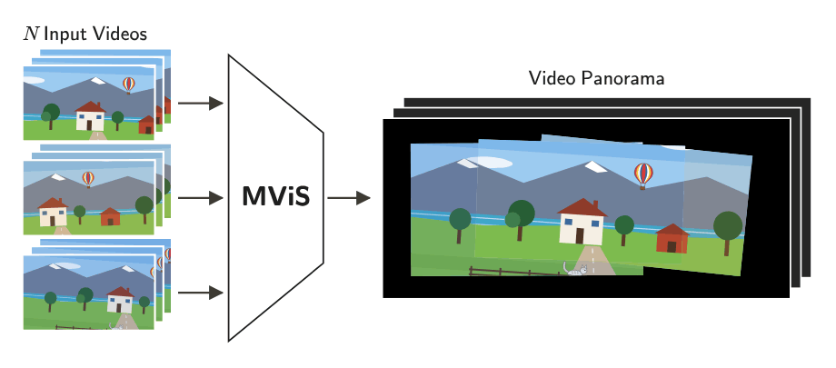

<div align="center">

<picture>
  <source media="(prefers-color-scheme: dark)" srcset="assets/venue-dark.svg">
  
</picture>

<h1>
  <picture>
    <source media="(prefers-color-scheme: dark)" srcset="assets/title-dark.svg">
    
  </picture>
</h1>

<p>
  <a href="https://shiraif.github.io/"><picture><source media="(prefers-color-scheme: dark)" srcset="assets/names/shira-ifergane-dark.svg"></picture></a> &nbsp;&nbsp;
  <a href="https://royamoyal.github.io/"><picture><source media="(prefers-color-scheme: dark)" srcset="assets/names/roy-amoyal-dark.svg"></picture></a> &nbsp;&nbsp;
  <a href="https://www.linkedin.com/in/shahar-ben-ishay/"><picture><source media="(prefers-color-scheme: dark)" srcset="assets/names/shahar-benishay-dark.svg"></picture></a> &nbsp;&nbsp;
  <a href="https://www.orenfreifeld.com/"><picture><source media="(prefers-color-scheme: dark)" srcset="assets/names/oren-freifeld-dark.svg"></picture></a>
</p>

Ben-Gurion University of the Negev

<br>

<p>
  <a href="https://bgu-cs-vil.github.io/MViS-project/"></a>&nbsp;
  <a href="https://neurips.cc/virtual/2026/poster/154835"></a>&nbsp;
  &nbsp;
  
</p>

<sub>*Paper and dataset coming soon</sub>

<br>

***The first video stitching method capable of handling more than 2 freely moving cameras***

</div>

---

## Overview

This is the official implementation of the NeurIPS 2026 paper "Video Stitching from Multiple Moving Cameras".

**MViS** (**M**ultiple **Vi**deo **S**titching) is a test-time optimization method that aligns videos from any
number of freely moving cameras, with no fixed or known camera ordering and a view-intersection graph that may
change over time. It turns `N` videos from moving cameras into one panoramic video.

<p align="center">
  <picture>
    <source media="(prefers-color-scheme: dark)" srcset="assets/mvis_intro_dark.gif">
    
  </picture>
  <br>
  <em>Schematic on a synthetic scene with N = 3.</em>
</p>

What's in this repository:

| File | What it does |
| --- | --- |
| `demo.py` | Stitches the videos of a new scene into a panoramic video. |
| `train.py` | Exposes all of the options (matcher, epochs, learning rates, ...) and runs on the MMCD and StabStitch-D datasets. |
| `mcb_metrics.py` | Implements the GV metric (class `GV`). |

## Installation

```bash
conda create -n mvis python=3.12.9
conda activate mvis
pip install -r requirements.txt
```

The pretrained RoMa and DINOv2 weights (and the LoFTR weights, with `--matcher LoFTR`) are downloaded on the first run.

## Quick Start: Stitch Your Own Videos

### 1. Arrange the frames

A scene is a folder with one folder of frames per video, named `video0`, `video1`, ...:

```
<scene>/
├── video0/
│   ├── 0001.jpg
│   ├── 0002.jpg
│   └── ...
├── video1/
│   └── ...
└── ...
```

The number of videos is the number of `video<i>` folders. MViS assumes that:

- the videos are approximately synchronized, and
- at each time, the view-intersection graph is connected: every video overlaps with at least one other, and
  any two videos are linked through a chain of overlapping videos.

### 2. Run MViS

```bash
python demo.py --scene_folder path/to/<scene> --video both
```

### 3. Get the panoramic videos

The panoramic videos are saved to `results/<scene>/`:

| `‑‑video` | Output | What you see |
| :---: | --- | --- |
| `fixed` | `fixed_panorama_<scene>.mp4` | Video 0 stays fixed and the other videos move relative to it. |
| `moving` | `moving_panorama_<scene>.mp4` | All of the videos, including video 0, move in one shared panoramic coordinate system, whose reference is the first frame of video 0. |

`--video both` saves both. The choice affects only the visualization, not the alignment.

### More options

For all of the options (matcher, epochs, learning rates, ...), run the scene through `train.py`:

```bash
python train.py --data_folder path/to/<scene> --panoramic_video_type both
python train.py --help
```

## Compute Metrics

### The Multi-Camera Benchmark (MMCD)

Download MMCD and place it next to the repository
(or pass `--data_folder` for another location):

```
../MMCD/
├── frames/
│   └── <scene>/
│       ├── video0/
│       ├── video1/
│       └── ...
└── kps_annotations/
    └── <scene>/
        ├── kps_<scene>.pt
        └── pred_visibility_<scene>.pt
```

Run the benchmark on all of the scenes:

```bash
python train.py --dataset MMCD
```

Run a single scene, with its metrics:

```bash
python train.py --dataset MMCD --scene <scene>
```

### StabStitch-D

[StabStitch-D](https://github.com/nie-lang/StabStitch) is expected at `../stabstitch-d/<scene>/video<i>/`
(pass `--data_folder` for another location). To run it and compute the metrics:

```bash
python train.py --dataset StabStitch-D
```

## Citation

If you find MViS, the MMCD dataset, the Multi-Camera Benchmark, or the GV metric useful in your research, please cite:

```bibtex
@inproceedings{Ifergane:NeurIPS:2026:MViS,
  title     = {Video Stitching from Multiple Moving Cameras},
  author    = {Ifergane, Shira and Amoyal, Roy and Benishay, Shahar and Freifeld, Oren},
  booktitle = {Advances in Neural Information Processing Systems (NeurIPS)},
  year      = {2026}
}
```